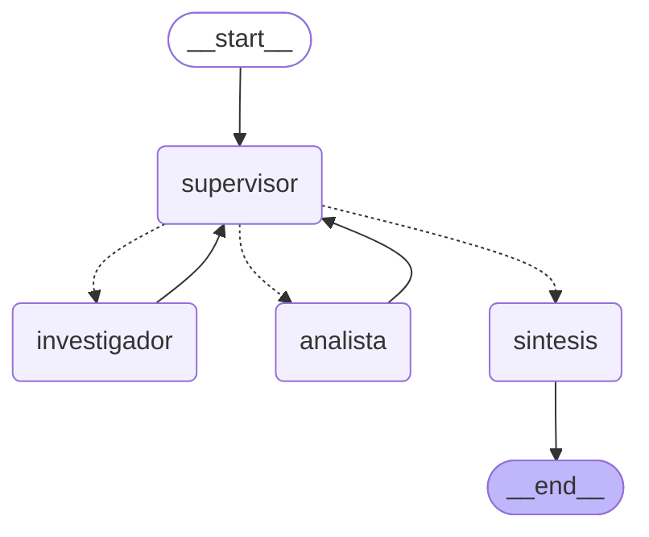

# Orquestador multi-agente de análisis e investigación

Prototipo de un orquestador multi-agente con LangGraph. Un **Supervisor** recibe la solicitud del usuario y decide, paso a paso, qué especialista debe intervenir:

- un **Investigador**, que busca datos en un Vector DB (el índice de Pinecone de la pre-entrega 4);
- un **Analista**, que hace cálculos con esos datos.

Cuando la tarea está completa y validada, una fase de **síntesis** redacta la respuesta final.

## Diagrama del grafo

Generado con `app.get_graph().draw_mermaid_png()` (ver [`graph.png`](graph.png)):




Las flechas punteadas son las aristas condicionales: las decide el supervisor en cada paso. Las flechas continuas son fijas: los especialistas siempre devuelven el control al supervisor.

## Ejemplo de ejecución

Salida de una ejecución real de `python main.py`, con las líneas largas acortadas y las fórmulas del analista pasadas a texto plano. La consulta requiere dos dominios: buscar un dato en la documentación y hacer un cálculo con él.

```
🧑 Consulta: Según la documentación de logging, ¿qué valores de maxBytes y backupCount usa el ejemplo
de RotatingFileHandler? Con esa configuración, ¿cuánto espacio en disco pueden ocupar como máximo los
logs (el archivo actual más sus copias), en bytes y en megabytes?

🔹 supervisor
   → instrucción para investigador: Busca en la documentación técnica de Python el ejemplo de
     RotatingFileHandler y extrae los valores exactos de maxBytes y backupCount utilizados, citando la fuente.
   [supervisor] Decisión: investigador. No hay aportes previos. Se necesitan primero los datos concretos
     de la documentación técnica antes de realizar cualquier cálculo.
🔹 investigador
   [investigador] - `maxBytes = 1_000_000`
   - `backupCount = 3`
   Fuente: `logging.md`
🔹 supervisor
   → instrucción para analista: Calcula el espacio total máximo en disco (maxBytes * (backupCount + 1))
     en bytes y conviértelo a megabytes usando los datos obtenidos por el investigador.
   [supervisor] Decisión: analista. El investigador ya obtuvo los datos de la documentación, pero falta
     que el analista realice el cálculo requerido por la tarea.
🔹 analista
   [analista] 1. Operación en bytes: 1_000_000 × (3 + 1) = 4_000_000 bytes
   2. Conversión a megabytes: 4_000_000 ÷ (1024 × 1024) ≈ 3.81 MB
🔹 supervisor
   [supervisor] Decisión: FINISH. El investigador obtuvo los datos exactos citando la fuente y el analista
     realizó correctamente los cálculos solicitados (en bytes y megabytes). Se cumplen todos los puntos de la rúbrica.
🔹 sintesis
   [sintesis] Según la documentación de Python (`logging.md`), el ejemplo de `RotatingFileHandler`
   utiliza maxBytes = 1.000.000 y backupCount = 3. Con esta configuración, el espacio total máximo que
   pueden ocupar los logs en disco es de 4.000.000 bytes, aproximadamente 3,81 MB.
```

El notebook [`demo_delegacion.ipynb`](demo_delegacion.ipynb) muestra el mismo flujo ejecutado, con el diagrama, la delegación paso a paso, el registro de contribuciones del estado compartido y la respuesta final.

## Estructura del repositorio

```
orquestador-multi-agente/
├── state.py                  # Esquema de estado compartido (AgentState)
├── agents/
│   ├── research_agent.py     # Agente de Búsqueda/Investigación + herramienta sobre el Vector DB
│   └── analyst_agent.py      # Agente de Análisis/Cómputo + calculadora
├── graph.py                  # Supervisor, síntesis y construcción del StateGraph
├── main.py                   # Prueba de la interacción por consola
├── config.py                 # Modelo de lenguaje y conexión al Vector DB
├── demo_delegacion.ipynb     # Notebook que demuestra el flujo de delegación
├── graph.png                 # Diagrama del grafo
├── requirements.txt
├── .env.example
└── .gitignore
```

## Topología elegida: jerárquica con supervisor

Se eligió una topología **jerárquica** (un supervisor que coordina a especialistas), en lugar de una cadena fija o de agentes que se hablan entre sí, por tres razones:

1. **El orden de los pasos depende de la consulta.** Algunas preguntas necesitan investigar y calcular, otras solo investigar, y a veces hay que repetir un paso. Un supervisor que decide en cada turno se adapta a cada caso; una cadena fija no.
2. **Un único punto de control.** Toda decisión pasa por el supervisor, que puede validar los aportes y pedir correcciones antes de cerrar. Si los agentes se derivaran tareas entre ellos, no habría un lugar central que controle la calidad ni que corte el flujo.
3. **Especialistas simples y acotados.** Cada especialista solo resuelve su parte con su herramienta; la coordinación queda toda en el supervisor.

### Cómo se manejan los conflictos entre agentes

- **Roles que no se superponen:** el investigador no puede calcular (su prompt lo prohíbe y no tiene calculadora) y el analista no puede buscar información (no tiene acceso al Vector DB). Así no producen versiones distintas del mismo dato.
- **Una sola fuente de verdad para los datos:** el analista solo trabaja con los datos que aportó el investigador; su prompt le prohíbe inventar datos que no estén en el contexto.
- **El supervisor arbitra:** antes de terminar revisa los aportes con una rúbrica (ver abajo). Si un aporte no cumple, por ejemplo un cálculo inconsistente con los datos o datos sin fuente, devuelve la tarea al especialista que corresponde con una instrucción de corrección.
- **Trazabilidad:** cada aporte queda registrado en el estado con el agente que lo hizo y la instrucción que recibió, así se puede ver de dónde salió cada dato.
- **Corte garantizado:** si los agentes no llegan a un resultado válido, el límite de pasos evita un bucle infinito de correcciones (ver "Condición de parada").

## Cómo funciona

| Pedido de la consigna | Dónde está |
|---|---|
| `state.py` con el esquema de datos compartido | `state.py` → `AgentState` |
| `agents/` con los especialistas | `agents/research_agent.py`, `agents/analyst_agent.py` |
| Grafo principal con `StateGraph` | `graph.py` → `construir_grafo()` |
| Supervisor que decide el flujo con `Literal` en el retorno | `graph.py` → `nodo_supervisor()` y `enrutar()` |
| Herramientas funcionales | `buscar_en_documentacion` (Vector DB) y `calculadora` |
| Validación antes del `END` | Rúbrica en el prompt del supervisor (`SUPERVISOR_PROMPT`) |
| Fase de síntesis final | `graph.py` → `nodo_sintesis()` |
| Diagrama del grafo | `graph.png` y diagrama Mermaid en este README |
| Demo del flujo de delegación | `demo_delegacion.ipynb` |

### Estado compartido (`state.py`)

`AgentState` hereda de `MessagesState`, que es un `TypedDict` con la lista `messages`, y suma:

| Campo | Para qué sirve |
|---|---|
| `next_agent` | Próximo nodo elegido por el supervisor (`investigador`, `analista` o `FINISH`) |
| `instruccion` | Tarea puntual que el supervisor le deja al especialista elegido |
| `contribuciones` | Lista de aportes con `agente`, `instruccion` y `aporte`. Usa el reducer `operator.add`: cada aporte se agrega sin pisar los anteriores, así queda registrado qué agente contribuyó con qué información |
| `pasos` | Cantidad de intervenciones de especialistas |
| `task_completed` | Se marca en `True` cuando el supervisor decide finalizar |

### Especialistas (`agents/`)

Los dos se crean con `create_react_agent` de LangGraph, cada uno con un prompt de rol y **una sola herramienta**:

- **Investigador** (`research_agent.py`): su herramienta `buscar_en_documentacion` hace una búsqueda por similitud en el **Vector DB de la pre-entrega 4**: el índice de Pinecone `rag-hibrido-python-docs` (namespace `python-stdlib-docs`), con documentación de los módulos `pathlib`, `json`, `logging`, `collections` y `datetime`. Usa el mismo modelo de embeddings con el que se indexó (`gemini-embedding-001`, 1536 dimensiones).
- **Analista** (`analyst_agent.py`): su herramienta `calculadora` evalúa expresiones aritméticas. No usa `eval()`, porque el texto de la expresión lo genera un LLM y `eval()` permitiría ejecutar código arbitrario: la expresión se analiza con el módulo `ast` y solo se permiten números y las operaciones `+ - * / **`.

**Contexto acotado (para evitar la contaminación de contexto):** ningún especialista recibe el historial completo del sistema. El investigador recibe solo la instrucción del supervisor; el analista recibe la instrucción más los datos que aportó el investigador.

### Supervisor (`graph.py`)

El supervisor usa `with_structured_output` para devolver una decisión con tres campos: `next` (de tipo `Literal["investigador", "analista", "FINISH"]`), `instruccion` y `razon`. Su prompt plantea la pregunta: *"Dada la conversación actual, ¿quién debe intervenir ahora o es momento de finalizar?"*.

La función `enrutar()` traduce esa decisión al nombre del nodo siguiente. Su tipo de retorno es `Literal["investigador", "analista", "sintesis"]`, y es la que usan las aristas condicionales (`add_conditional_edges`).

**Rúbrica de validación.** Antes de responder `FINISH`, el supervisor verifica que:

- a) los datos vienen de un aporte del investigador que cita su fuente;
- b) si la tarea pide un cálculo, el analista lo hizo con su herramienta y es consistente con los datos;
- c) los aportes cubren todo lo que pide la tarea.

Si algo no se cumple, devuelve la tarea al especialista que corresponde para que refine su aporte.

**Condición de parada.** `MAX_PASOS = 6`: después de 6 intervenciones de especialistas, el supervisor pasa a la síntesis aunque el LLM quiera seguir delegando. Además, `main.py` invoca el grafo con `recursion_limit=20` como techo adicional.

### Síntesis

Cuando el supervisor decide `FINISH`, el nodo `sintesis` redacta la respuesta final combinando solo los aportes registrados en el estado, sin agregar datos nuevos.

## Cómo ejecutarlo

**Requisito previo:** el índice de Pinecone de la pre-entrega 4 tiene que existir y estar cargado en tu cuenta. Se crea con el repositorio [sistema-rag-escalable-pinecone](https://github.com/Miqueasm14/sistema-rag-escalable-pinecone) (`python setup_index.py` y `python ingest.py`), usando la misma `PINECONE_API_KEY`.

Requiere Python 3.12.

**PowerShell (Windows):**
```powershell
python -m venv .venv
.venv\Scripts\Activate.ps1
pip install -r requirements.txt
```

Si PowerShell bloquea la activación del entorno virtual, corré una sola vez:
```powershell
Set-ExecutionPolicy -Scope Process -ExecutionPolicy RemoteSigned
```

**Git Bash / Linux / macOS:**
```bash
python -m venv .venv
source .venv/Scripts/activate    # en Linux/macOS: source .venv/bin/activate
pip install -r requirements.txt
```

**Configurar y ejecutar:**
```bash
cp .env.example .env
# completar GOOGLE_API_KEY y PINECONE_API_KEY

python main.py     # corre la consulta de prueba y muestra el flujo de delegación
python graph.py    # regenera graph.png con draw_mermaid_png()
```

Para ver la demo interactiva, abrí `demo_delegacion.ipynb` en VS Code o Jupyter, elegí el kernel del entorno virtual `.venv` y ejecutá todas las celdas.

## Variables de entorno

| Variable | Para qué se usa |
|---|---|
| `GOOGLE_API_KEY` | Modelo de lenguaje (Gemini) y embeddings para consultar el Vector DB |
| `PINECONE_API_KEY` | Conexión al Vector DB de la pre-entrega 4 |
| `INDEX_NAME` | Nombre del índice de Pinecone (por defecto `rag-hibrido-python-docs`) |

El `.env` está en `.gitignore`: nunca se sube al repositorio.

## Notas

- El modelo es `gemini-flash-lite-latest`. En el plan gratuito, cada modelo de Gemini tiene un límite de pedidos por día, y cada consulta al orquestador hace alrededor de 8. Si aparece un error `429 RESOURCE_EXHAUSTED`, se agotó la cuota diaria.
- Al usar Gemini, la librería muestra un aviso sobre "automatic function calling (AFC)". Es informativo y no afecta al orquestador.
